# FitNest Gym – Locker Room Management System
**Backend Development Fundamentals (BDF) Group Assignment**

[](https://nodejs.org/)
[](https://expressjs.com/)
[](https://www.sqlite.org/)
[](https://jestjs.io/)

---

## 1. Project Introduction

**FitNest Gym – Locker Room Management System** is a robust, modular, production-ready RESTful backend API designed to handle member registrations, locker inventories, locker allocations, and collision-free gym locker room operations.

Built for the **B.Tech Backend Development Fundamentals (BDF)** group assignment, this system implements end-to-end CRUD operations, relational SQLite database architecture with foreign key constraints, case-insensitive duplicate prevention, SQL `JOIN` aggregations, query parameter search/filtering, and comprehensive automated test suites.

---

## 2. Problem Statement

Fitness facilities and commercial gyms face significant operational challenges when tracking locker allocations manually or through naive databases:
1. **Locker Collisions & Double Booking**: Multiple members inadvertently allotted to the same locker at the same time.
2. **Case-Insensitive Duplicate Lockers**: Administrative errors causing `"Locker 12"`, `"locker 12"`, and `"LOCKER 12"` to be registered as separate lockers, confusing staff and gym patrons.
3. **Data Inconsistency**: Orphaned allocations, unvalidated input formats, and lack of relational constraints when members or lockers are modified or deleted.
4. **Inefficient Search and Reporting**: Gym desks requiring fast queries by floor (`GET /lockers?floor=2`) and aggregated reports linking member information, locker numbers, and start/end dates.

**FitNest Gym** solves each of these challenges through strict schema constraints, application-layer duplicate prevention, relational integrity, and automated testing.

---

## 3. Technology Stack

- **Runtime**: [Node.js](https://nodejs.org/) (v20+)
- **Framework**: [Express.js](https://expressjs.com/) (v4.21+)
- **Database**: [SQLite3](https://www.sqlite.org/) (with PRAGMA foreign keys enabled)
- **Language**: JavaScript (ES6+ with `async`/`await`)
- **Testing Frameworks**: [Jest](https://jestjs.io/) and [Supertest](https://github.com/ladjs/supertest)
- **API Client & Documentation**: [Postman](https://www.postman.com/) (Postman Collection v2.1.0)
- **Middleware**: `cors`, `dotenv`, custom input validation & centralized error handling

---

## 4. Project Structure

The project follows a clean, layered MVC backend folder structure:

```text
fitnest-gym-locker-system/
│
├── src/
│   ├── app.js                         # Express application setup, routes & middleware
│   ├── server.js                      # Server startup, port listener & graceful shutdown
│   ├── database/
│   │   ├── connection.js              # Promisified SQLite3 wrapper (run, get, all, close)
│   │   ├── init.js                    # Database tables, foreign keys, constraints & indexes
│   │   ├── seed.js                    # Initial demo seed data
│   │   └── fitnest.db                 # SQLite database file (created on runtime)
│   ├── middleware/
│   │   ├── validator.js               # Request payload & parameter validation
│   │   ├── notFound.js                # 404 Route Not Found middleware
│   │   └── errorHandler.js            # Centralized error handler & status mapper
│   ├── controllers/
│   │   ├── memberController.js       # Member CRUD & duplicate email checks
│   │   ├── lockerController.js       # Locker CRUD, search & case-insensitive validation
│   │   └── allotmentController.js    # Allotment management & SQL JOIN aggregation
│   └── routes/
│       ├── memberRoutes.js           # /members routes
│       ├── lockerRoutes.js           # /lockers routes
│       └── allotmentRoutes.js        # /allotments routes (including /details)
│
├── tests/
│   ├── twist.test.js                  # Explicit 3 Twist tests for case-insensitive duplicate lockers
│   ├── lockers.test.js                # Full locker CRUD & query search tests
│   ├── members.test.js                # Full member CRUD & validation tests
│   └── allotments.test.js             # Allotments, conflict prevention & JOIN endpoint tests
│
├── scripts/
│   └── verify-endpoints.js            # Interactive CLI verification script
│
├── FitNest_Gym_Locker_System.postman_collection.json # Complete Postman collection
├── .env.example                       # Environment variable template
├── .env                               # Active environment configuration
├── .gitignore                         # Git ignored files & directories
├── package.json                       # Project dependencies and npm scripts
└── README.md                          # Comprehensive documentation
```

---

## 5. Database Schema & Constraints

The SQLite database consists of **exactly three related tables**: `members`, `lockers`, and `allotments`. Foreign key constraints (`PRAGMA foreign_keys = ON;`) are strictly enforced.

```
 +-------------------------------------+       +------------------------------------+
 |               members               |       |              lockers               |
 +-------------------------------------+       +------------------------------------+
 | id INTEGER PRIMARY KEY AUTOINCREMENT|       | id INTEGER PRIMARY KEY AUTOINCREMENT|
 | name TEXT NOT NULL                  |       | name TEXT NOT NULL UNIQUE NOCASE   |
 | email TEXT NOT NULL UNIQUE NOCASE   |       | floor INTEGER NOT NULL             |
 | phone TEXT                          |       | status TEXT NOT NULL DEFAULT avail |
 | membership_type TEXT DEFAULT Stand..|       | created_at DATETIME CURRENT_TIMEST.|
 | created_at DATETIME CURRENT_TIMEST. |       | updated_at DATETIME CURRENT_TIMEST.|
 | updated_at DATETIME CURRENT_TIMEST. |       +-----------------+------------------+
 +------------------+------------------+                         |
                    |                                            |
                    | (1:N)                                      | (1:N)
                    |                                            |
                    +--------------------+   +-------------------+
                                         |   |
                                +--------v---v-----------------------+
                                |             allotments             |
                                +------------------------------------+
                                | id INTEGER PRIMARY KEY AUTOINCREMENT|
                                | member_id INTEGER (FK -> members)  |
                                | locker_id INTEGER (FK -> lockers)  |
                                | start_date DATETIME CURRENT_TIMEST.|
                                | end_date DATETIME                  |
                                | status TEXT NOT NULL DEFAULT active|
                                | created_at DATETIME CURRENT_TIMEST.|
                                | updated_at DATETIME CURRENT_TIMEST.|
                                +------------------------------------+
```

### Table Definitions

#### 1. `members` Table
```sql
CREATE TABLE IF NOT EXISTS members (
  id INTEGER PRIMARY KEY AUTOINCREMENT,
  name TEXT NOT NULL,
  email TEXT NOT NULL UNIQUE COLLATE NOCASE,
  phone TEXT,
  membership_type TEXT DEFAULT 'Standard',
  created_at DATETIME DEFAULT CURRENT_TIMESTAMP,
  updated_at DATETIME DEFAULT CURRENT_TIMESTAMP
);
```

#### 2. `lockers` Table
```sql
CREATE TABLE IF NOT EXISTS lockers (
  id INTEGER PRIMARY KEY AUTOINCREMENT,
  name TEXT NOT NULL UNIQUE COLLATE NOCASE,
  floor INTEGER NOT NULL,
  status TEXT NOT NULL DEFAULT 'available',
  created_at DATETIME DEFAULT CURRENT_TIMESTAMP,
  updated_at DATETIME DEFAULT CURRENT_TIMESTAMP
);
CREATE INDEX IF NOT EXISTS idx_lockers_floor ON lockers(floor);
```

#### 3. `allotments` Table
```sql
CREATE TABLE IF NOT EXISTS allotments (
  id INTEGER PRIMARY KEY AUTOINCREMENT,
  member_id INTEGER NOT NULL,
  locker_id INTEGER NOT NULL,
  start_date DATETIME DEFAULT CURRENT_TIMESTAMP,
  end_date DATETIME,
  status TEXT NOT NULL DEFAULT 'active',
  created_at DATETIME DEFAULT CURRENT_TIMESTAMP,
  updated_at DATETIME DEFAULT CURRENT_TIMESTAMP,
  FOREIGN KEY (member_id) REFERENCES members(id) ON DELETE CASCADE,
  FOREIGN KEY (locker_id) REFERENCES lockers(id) ON DELETE CASCADE
);
CREATE INDEX IF NOT EXISTS idx_allotments_member ON allotments(member_id);
CREATE INDEX IF NOT EXISTS idx_allotments_locker ON allotments(locker_id);
```

---

## 6. API Endpoint Documentation

Base URL: `http://localhost:3000`

### 1. Lockers API (`/lockers`)

| Method | Endpoint | Description | Status Code |
| :--- | :--- | :--- | :--- |
| `GET` | `/lockers` | List all lockers (supports search: `?floor=2`, `?status=available`, `?search=12`) | **200 OK** |
| `GET` | `/lockers/:id` | Retrieve single locker by ID | **200 OK** / **404 Not Found** |
| `POST` | `/lockers` | Create new locker (checks case-insensitive duplicate) | **201 Created** / **400 Bad Request** / **409 Conflict** |
| `PUT` | `/lockers/:id` | Update locker (checks duplicate excluding current locker) | **200 OK** / **400 Bad Request** / **404** / **409** |
| `DELETE` | `/lockers/:id` | Delete locker (prevents deletion if active allotment exists) | **200 OK** / **404 Not Found** / **409 Conflict** |

#### Search Example:
`GET /lockers?floor=2`
```json
[
  {
    "id": 4,
    "name": "Locker 10",
    "floor": 2,
    "status": "occupied",
    "created_at": "2026-11-15 06:35:31",
    "updated_at": "2026-11-15 06:35:31"
  },
  {
    "id": 5,
    "name": "Locker 11",
    "floor": 2,
    "status": "available",
    "created_at": "2026-11-15 06:35:31",
    "updated_at": "2026-11-15 06:35:31"
  }
]
```

---

### 2. Duplicate Locker Name Prevention (Twist Requirement)

Locker names are strictly unique regardless of uppercase or lowercase letters:
`"Locker 12"`, `"locker 12"`, and `"LOCKER 12"` are treated as identical.

- **Creating Duplicate**:
  ```http
  POST /lockers
  Content-Type: application/json

  {
    "name": "locker 12",
    "floor": 2
  }
  ```
  **HTTP 409 Conflict**:
  ```json
  {
    "error": "Locker 12 already exists"
  }
  ```

- **Updating Another Locker to an Existing Name**:
  ```http
  PUT /lockers/8
  Content-Type: application/json

  {
    "name": "Locker 12"
  }
  ```
  **HTTP 409 Conflict**:
  ```json
  {
    "error": "Locker 12 already exists"
  }
  ```

- **Self-Update Exclusion**:
  Updating `"Locker 12"` (ID: 7) with `{"name": "Locker 12", "floor": 3}` returns **200 OK** because the locker is excluded from its own collision check.

---

### 3. Allotments API (`/allotments`)

| Method | Endpoint | Description | Status Code |
| :--- | :--- | :--- | :--- |
| `GET` | `/allotments` | List all allotments (supports `?status=active`) | **200 OK** |
| `GET` | `/allotments/:id` | View individual allotment by ID | **200 OK** / **404 Not Found** |
| `POST` | `/allotments` | Create allotment (prevents assigning occupied locker) | **201 Created** / **400** / **404** / **409** |
| `PUT` | `/allotments/:id` | Update allotment (return locker, change status) | **200 OK** / **404** / **409** |
| `DELETE` | `/allotments/:id` | Delete allotment and free up locker | **200 OK** / **404 Not Found** |

#### Preventing Double Booking:
If a locker is already occupied by an active allotment:
**HTTP 409 Conflict**:
```json
{
  "error": "Locker 'Locker 01' is already occupied and cannot be allotted"
}
```

---

### 4. SQL JOIN Endpoint (`/allotments/details`)

Returns allotments with:
- Allotment ID
- Member name
- Locker name
- Relevant allotment details (member email, phone, locker floor, status, dates)

```http
GET /allotments/details
```

**SQL Query Executed**:
```sql
SELECT 
  a.id AS allotment_id,
  m.id AS member_id,
  m.name AS member_name,
  m.email AS member_email,
  m.phone AS member_phone,
  m.membership_type,
  l.id AS locker_id,
  l.name AS locker_name,
  l.floor AS locker_floor,
  l.status AS locker_status,
  a.start_date,
  a.end_date,
  a.status AS allotment_status,
  a.created_at,
  a.updated_at
FROM allotments a
INNER JOIN members m ON a.member_id = m.id
INNER JOIN lockers l ON a.locker_id = l.id
ORDER BY a.id DESC;
```

**Response (HTTP 200 OK)**:
```json
[
  {
    "allotment_id": 2,
    "member_id": 2,
    "member_name": "Samantha Miller",
    "member_email": "samantha.m@fitnest.com",
    "member_phone": "555-0102",
    "membership_type": "Standard",
    "locker_id": 4,
    "locker_name": "Locker 10",
    "locker_floor": 2,
    "locker_status": "occupied",
    "start_date": "2026-11-15 06:35:31",
    "end_date": null,
    "allotment_status": "active",
    "created_at": "2026-11-15 06:35:31",
    "updated_at": "2026-11-15 06:35:31"
  },
  {
    "allotment_id": 1,
    "member_id": 1,
    "member_name": "Alex Johnson",
    "member_email": "alex.johnson@fitnest.com",
    "member_phone": "555-0101",
    "membership_type": "Premium",
    "locker_id": 1,
    "locker_name": "Locker 01",
    "locker_floor": 1,
    "locker_status": "occupied",
    "start_date": "2026-11-15 06:35:31",
    "end_date": null,
    "allotment_status": "active",
    "created_at": "2026-11-15 06:35:31",
    "updated_at": "2026-11-15 06:35:31"
  }
]
```

Also available for individual allotments: `GET /allotments/details/:id`.

---

### 5. Members API (`/members`)

| Method | Endpoint | Description | Status Code |
| :--- | :--- | :--- | :--- |
| `GET` | `/members` | List all members | **200 OK** |
| `GET` | `/members/:id` | Get member by ID | **200 OK** / **404 Not Found** |
| `POST` | `/members` | Create new member (validates email & duplicates) | **201 Created** / **400** / **409** |
| `PUT` | `/members/:id` | Update member details | **200 OK** / **400** / **404** / **409** |
| `DELETE` | `/members/:id` | Delete member (prevents delete if active allotment) | **200 OK** / **404** / **409** |

---

## 7. HTTP Status Code Conventions

The API consistently adheres to standard HTTP status codes:

- **`200 OK`**: Successful GET, PUT, or DELETE request.
- **`201 Created`**: Resource successfully created via POST.
- **`400 Bad Request`**: Missing required fields, invalid formats, or non-numeric IDs.
- **`404 Not Found`**: Requested member, locker, or allotment record does not exist.
- **`409 Conflict`**: Case-insensitive duplicate locker name, duplicate email, or attempting to allot an already-occupied locker.
- **`500 Internal Server Error`**: Unexpected server-side exception handled by centralized middleware.

---

## 8. Installation & Setup Instructions

### Prerequisites
- [Node.js](https://nodejs.org/) (version 18 or higher recommended)
- `npm` (bundled with Node.js)

### Steps

1. **Clone or Navigate to the Project Directory**:
   ```bash
   cd "C:\Users\uvaru\OneDrive\Desktop\GROUP ASS"
   ```

2. **Install Dependencies**:
   ```bash
   npm install
   ```

3. **Configure Environment Variables**:
   Copy `.env.example` to `.env` (already created by default):
   ```env
   PORT=3000
   NODE_ENV=development
   DB_PATH=./src/database/fitnest.db
   ```

4. **Seed Demo Data (Optional)**:
   ```bash
   node src/database/seed.js
   ```

5. **Start the Express Server**:
   ```bash
   npm start
   ```
   The server will start at:
   ```
   ====================================================
   FitNest Gym Server running on http://localhost:3000
   Health check: http://localhost:3000/
   Lockers:      http://localhost:3000/lockers
   Members:      http://localhost:3000/members
   Allotments:   http://localhost:3000/allotments
   JOIN Details: http://localhost:3000/allotments/details
   ====================================================
   ```

---

## 9. How to Run Automated Tests

The project includes 4 automated test suites powered by Jest and Supertest running on isolated in-memory SQLite instances:

### Run All Tests
```bash
npm test
```

### Run Specifically the Twist Tests
```bash
npx jest tests/twist.test.js --verbose
```

### Run the Interactive CLI Verification Script
```bash
node scripts/verify-endpoints.js
```

### Test Suite Summary:
```text
PASS tests/twist.test.js
PASS tests/allotments.test.js
PASS tests/lockers.test.js
PASS tests/members.test.js

Test Suites: 4 passed, 4 total
Tests:       49 passed, 49 total
Snapshots:   0 total
Time:        3.197 s
```

---

## 10. Twist Test Results

The assignment twist tests for case-insensitive duplicate name prevention and concurrency handling were explicitly implemented and verified:

| Test Case | Request | Expected Status | Actual Status | Result | Exact Response Body |
| :--- | :--- | :---: | :---: | :---: | :--- |
| **Test 1** | `POST /lockers` `{"name": "Locker 12", "floor": 2}` | **201** | **201** | **PASS** | `{"id": 7, "name": "Locker 12", "floor": 2, "status": "available", ...}` |
| **Test 2** | `POST /lockers` `{"name": "locker 12", "floor": 2}` | **409** | **409** | **PASS** | `{"error": "Locker 12 already exists"}` |
| **Test 2 Variant** | `POST /lockers` `{"name": "LOCKER 12", "floor": 1}` | **409** | **409** | **PASS** | `{"error": "Locker 12 already exists"}` |
| **Test 3 Setup** | `POST /lockers` `{"name": "Locker 99", "floor": 1}` | **201** | **201** | **PASS** | `{"id": 8, "name": "Locker 99", "floor": 1, ...}` |
| **Test 3** | `PUT /lockers/8` `{"name": "Locker 12"}` | **409** | **409** | **PASS** | `{"error": "Locker 12 already exists"}` |
| **Self-Update** | `PUT /lockers/7` `{"name": "Locker 12", "floor": 3}` | **200** | **200** | **PASS** | `{"id": 7, "name": "Locker 12", "floor": 3, ...}` |
| **Concurrency Test** | Parallel `POST /lockers` (6 simultaneous requests for `"Locker 55"`) | **1× 201, 5× 409** | **1× 201, 5× 409** | **PASS** | Exactly one succeeds with 201; five receive `{"error": "Locker 55 already exists"}` |

---

## 11. Postman Testing Instructions

A complete, pre-configured Postman Collection file with automated test scripts (`pm.test`) is included in the root directory:
[`FitNest_Gym_Locker_System.postman_collection.json`](file:///C:/Users/uvaru/OneDrive/Desktop/GROUP%20ASS/FitNest_Gym_Locker_System.postman_collection.json)

### Key Postman Collection Features:
- **34 Total Requests** across 5 structured folders.
- **68 Automated Assertions**: Every single request contains embedded `pm.test` status code and JSON body assertions.
- **Dynamic Variable Chaining**: Automatically extracts `createdMemberId`, `locker12Id`, `locker99Id`, and `createdAllotmentId` for subsequent operations.
- **End-to-End Repeatability**: Includes automated cleanup requests so the entire collection can be run repeatedly without manual database resets.

### Importing and Running in Postman:
1. Open the **Postman** application.
2. Click **Import** and select [`FitNest_Gym_Locker_System.postman_collection.json`](file:///C:/Users/uvaru/OneDrive/Desktop/GROUP%20ASS/FitNest_Gym_Locker_System.postman_collection.json).
3. The collection will appear under `FitNest Gym – Locker Room Management System`.
4. Click **Run Collection** to execute all 34 requests sequentially.
5. All 68 test assertions will pass with green badges.

---

## 12. Code Quality & Architecture Best Practices

- **Separation of Concerns**: Controllers handle business logic, database modules handle queries, routes define endpoints, and middleware handles cross-cutting concerns.
- **SQL Injection Safety**: All SQL statements use parameterized queries (`?`) without string interpolation.
- **Async/Await**: Native JavaScript asynchronous handling throughout the codebase.
- **Centralized Error Handling**: Express middleware captures all runtime and database constraint errors, ensuring consistent JSON responses across all endpoints.
- **Automatic Resource State Management**: When an allotment is created, its locker is marked `occupied`; when the allotment is completed, returned, or deleted, the locker is automatically returned to `available`.

---

## 13. Team Contributions & Division of Work

| Sl. | Team Member Name | Registration No. | Module / Role | Key Contributions & Code Files | Evidence Folder |
| :---: | :--- | :---: | :--- | :--- | :--- |
| **1** | **Ragiman Sai Jashwanth Reddy** | `252U1R7084` | Part 1: Server & Routes | Express application architecture, middleware pipelines, route mappings, server entrypoint, graceful shutdown (`src/server.js`, `src/app.js`, `src/routes/`). | [Evidence Folder](screenshots/01_Ragiman_Server_Routes) |
| **2** | **Palusa Sai Mokshith Goud** | `252U1R7074` | Part 2: Database | SQLite relational schema, foreign key constraints (`ON DELETE CASCADE`), indexes, seeder script, query wrapper (`src/database/init.js`, `connection.js`, `seed.js`). | [Evidence Folder](screenshots/02_Mokshith_Database) |
| **3** | **P Manish** | `252U1R7070` | Part 3: REST Endpoints | Full Member CRUD, Locker CRUD, Allotment lifecycle, multi-table SQL `INNER JOIN` query (`src/controllers/`). | [Evidence Folder](screenshots/03_Manish_REST_Endpoints) |
| **4** | **Maduru Sampath Kumar Reddy** | `252U1R7060` | Part 4: Validation & Search | Input validator middleware, floor query search, 404 handler, centralized error handler (`src/middleware/`, `src/controllers/lockerController.js`). | [Evidence Folder](screenshots/04_Sampath_Validation_Search) |
| **5** | **Uppari Varun Kumar** | `252U1R7094` | Part 5: Twist Rule | Case-insensitive duplicate locker prevention (`LOWER(TRIM(name))`), 409 Conflict handling, Jest test suites (`tests/twist.test.js`). | [Evidence Folder](screenshots/05_Varun_Twist_Rule) |
| **6** | **Yelluri Navadeep Kumar** | `252U1R7100` | Part 6: Postman & README | Postman collection test scripts (`pm.test`), dynamic variable chaining, isolated test environment runner, README documentation (`FitNest_Gym_...postman_collection.json`, `README.md`). | [Evidence Folder](screenshots/06_Navadeep_Postman_README) |

---

## 14. Evidence and Screenshots

The `screenshots/` directory contains dedicated verification checklists and capture guides for all six members:

### 14.1 Part 1 – Server & Routes: Ragiman Sai Jashwanth Reddy (`252U1R7084`)
- **Folder**: [`screenshots/01_Ragiman_Server_Routes/`](screenshots/01_Ragiman_Server_Routes)
- **Verified Screenshots Attached**:
  1. [`01_server_startup.png`](screenshots/01_Ragiman_Server_Routes/01_server_startup.png) – Server startup output on port 3000 showing all route URLs.
  2. [`02_health_check_endpoint.png`](screenshots/01_Ragiman_Server_Routes/02_health_check_endpoint.png) – `GET /` returning HTTP 200 OK with online status and documentation map.
  3. [`03_route_mounting_code.png`](screenshots/01_Ragiman_Server_Routes/03_route_mounting_code.png) – Route mounting configuration in `src/app.js` (lines 32–35).
  4. [`04_graceful_shutdown.png`](screenshots/01_Ragiman_Server_Routes/04_graceful_shutdown.png) – Clean server shutdown on `Ctrl+C` with database connection closed message.

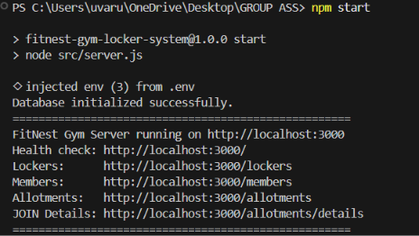
*Server Startup – FitNest Gym server running on http://localhost:3000 with all routes listed.*

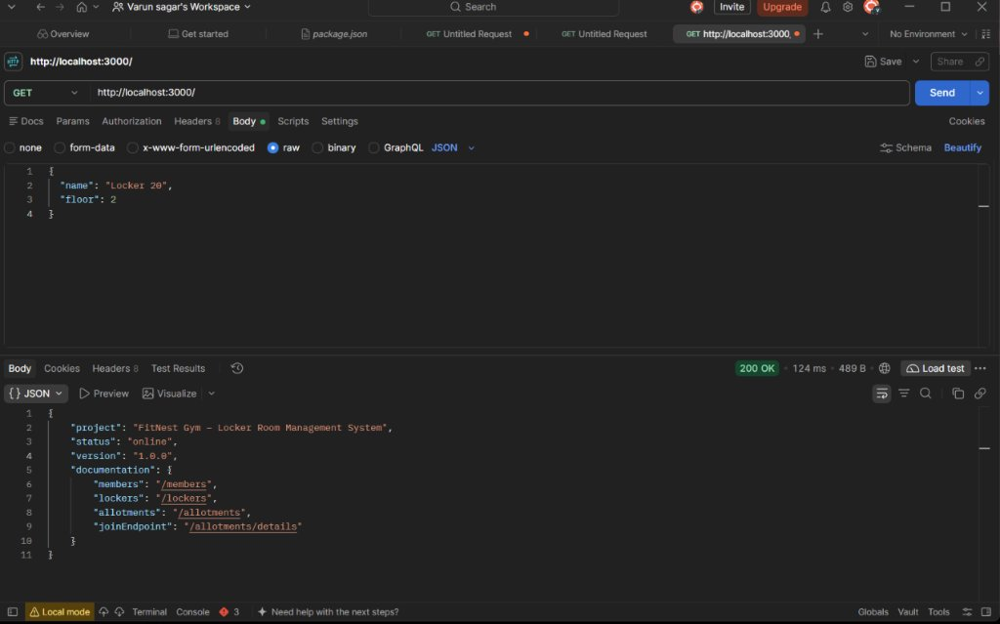
*Health Check Endpoint (200 OK) – GET / returns project name, status: online, and documentation links.*

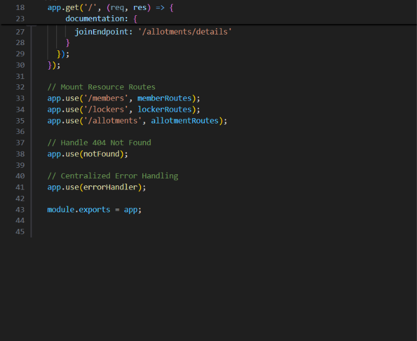
*Route Mounting Code – app.js mounting /members, /lockers, and /allotments routes.*

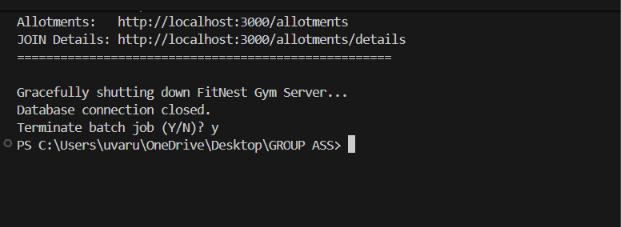
*Graceful Server Shutdown – Server closes database connection cleanly on SIGINT.*

### 14.2 Part 2 – Database: Palusa Sai Mokshith Goud (`252U1R7074`)
- **Folder**: [`screenshots/02_Mokshith_Database/`](screenshots/02_Mokshith_Database)
- **Verified Screenshots Attached**:
  1. [`01_sqlite_schema_init.png`](screenshots/02_Mokshith_Database/01_sqlite_schema_init.png) – `src/database/init.js` showing all 3 `CREATE TABLE` blocks with PKs, FKs, `COLLATE NOCASE`, and `ON DELETE CASCADE`.
  2. [`02_foreign_keys_pragma.png`](screenshots/02_Mokshith_Database/02_foreign_keys_pragma.png) – `src/database/connection.js` showing `PRAGMA foreign_keys = ON;` and `DB_PATH` resolver.
  3. [`03_database_seed_execution.png`](screenshots/02_Mokshith_Database/03_database_seed_execution.png) – Terminal: test database reset and seed execution confirming `fitnest.db` is UNCHANGED.
  4. [`04_sqlite_tables_verification.png`](screenshots/02_Mokshith_Database/04_sqlite_tables_verification.png) – Postman `GET /lockers` returning 200 OK with persisted locker records across floors 1, 2, 3.

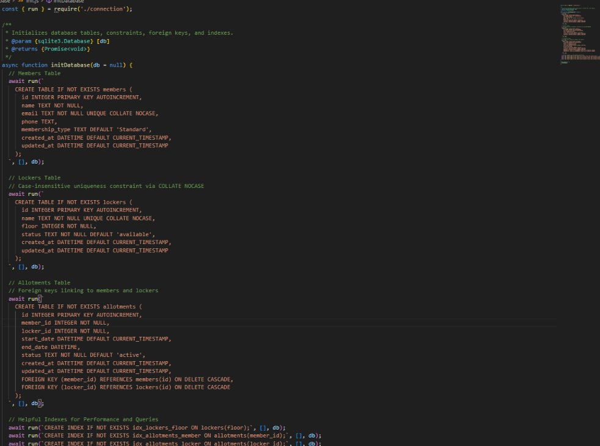
*SQLite Database Schema Initialization – `init.js` defining all three tables with primary keys, foreign keys, COLLATE NOCASE, and ON DELETE CASCADE.*

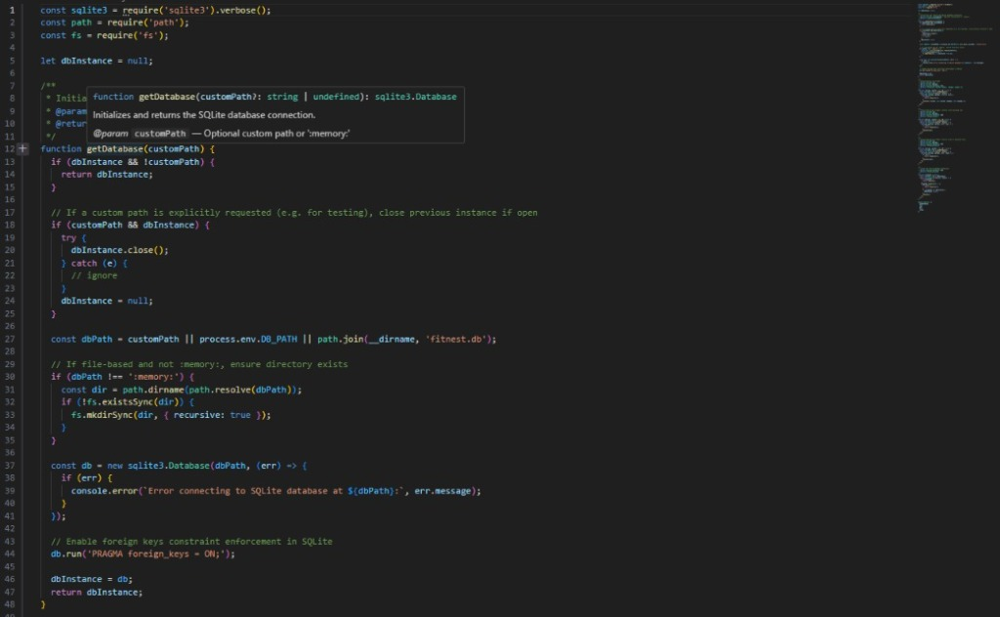
*Database Connection and Foreign Key Enforcement – `connection.js` enabling `PRAGMA foreign_keys = ON` on every connection.*

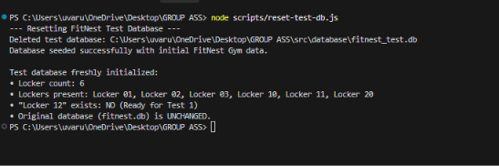
*Test Database Seed Execution – Test database reset and seeded with 6 lockers; production `fitnest.db` confirmed UNCHANGED.*

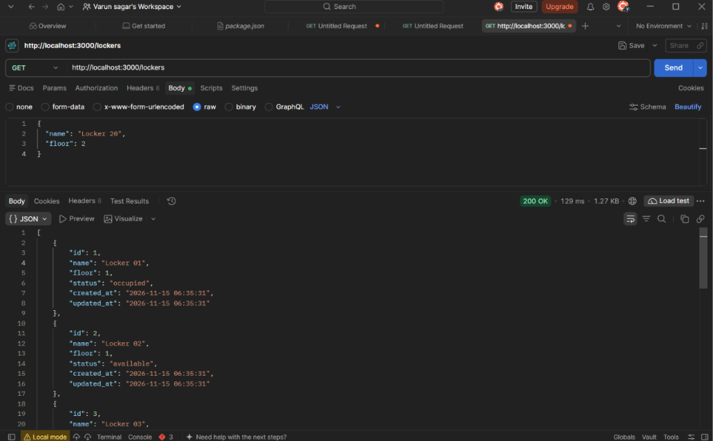
*SQLite Tables and Persisted Data Verification – Postman GET /lockers returning 200 OK with real persisted locker data.*

### 14.3 Part 3 – REST Endpoints: P Manish (`252U1R7070`)
- **Folder**: [`screenshots/03_Manish_REST_Endpoints/`](screenshots/03_Manish_REST_Endpoints)
- **Verified Screenshots Attached**:
  1. [`01_member_crud_postman.png`](screenshots/03_Manish_REST_Endpoints/01_member_crud_postman.png) – `GET /members` returning 200 OK with full member records (all fields visible).
  2. [`02_allotment_create_success.png`](screenshots/03_Manish_REST_Endpoints/02_allotment_create_success.png) – `POST /allotments` returning 201 Created with new allotment object (`member_id: 3`, `locker_id: 3`, `status: active`).
  3. [`03_allotment_occupied_conflict.png`](screenshots/03_Manish_REST_Endpoints/03_allotment_occupied_conflict.png) – `POST /allotments` returning 409 Conflict: `"Locker 'Locker 03' is already occupied and cannot be allotted"`.
  4. [`04_join_endpoint_response.png`](screenshots/03_Manish_REST_Endpoints/04_join_endpoint_response.png) – `GET /allotments/details` returning 200 OK with SQL JOIN data (member name, locker name, floor, allotment status).

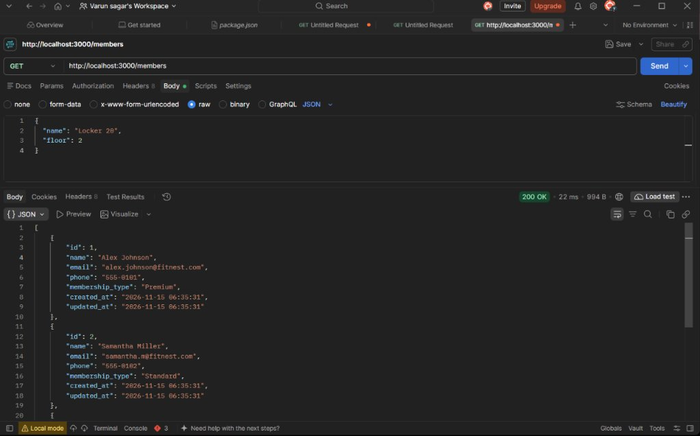
*GET Members – Retrieve All Members: GET /members returns 200 OK with all member records.*

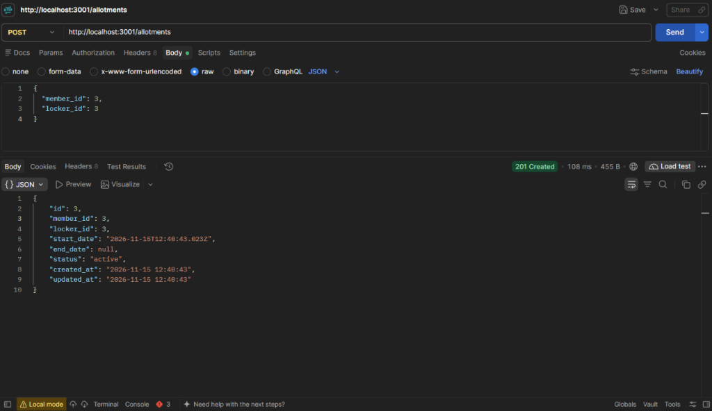
*POST Allotment – Successful Creation (201 Created): POST /allotments creates a new active allotment.*

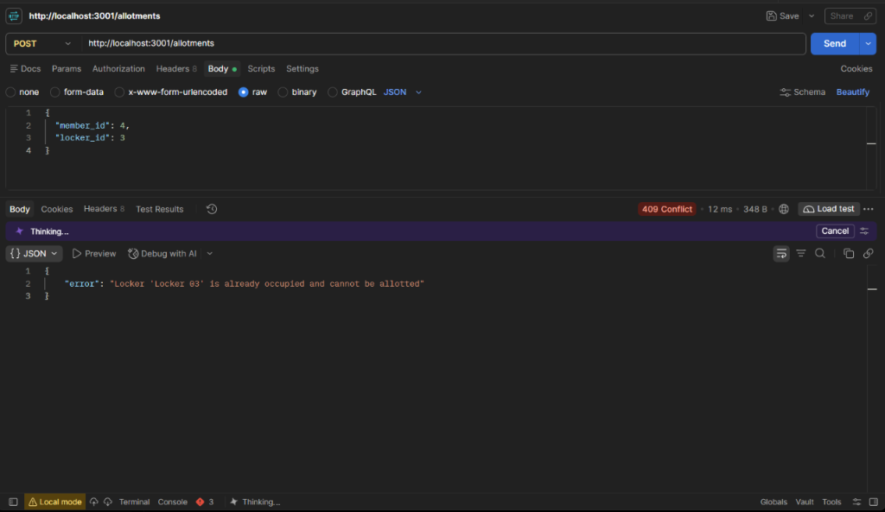
*POST Allotment – Conflict Handling (409 Conflict): Attempting to allot an already-occupied locker returns 409.*

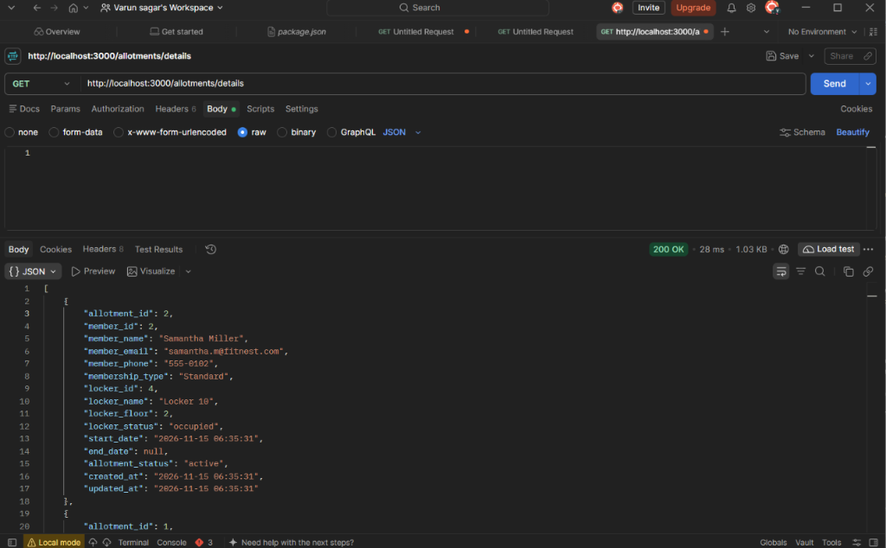
*GET Allotment Details – SQL JOIN Response: GET /allotments/details returns joined member, locker and allotment data.*

### 14.4 Part 4 – Validation & Search: Maduru Sampath Kumar Reddy (`252U1R7060`)
- **Folder**: [`screenshots/04_Sampath_Validation_Search/`](screenshots/04_Sampath_Validation_Search)
- **Verified Screenshots Attached**:
  1. [`01_search_lockers_by_floor.png`](screenshots/04_Sampath_Validation_Search/01_search_lockers_by_floor.png) – `GET /lockers?floor=2` returning HTTP 200 OK with only lockers situated on floor 2 (`Locker 10`, `Locker 11`).
  2. [`02_validation_error_400.png`](screenshots/04_Sampath_Validation_Search/02_validation_error_400.png) – `POST /lockers` returning HTTP 400 Bad Request with error: `"Locker name is required and must be a non-empty string"`.
  3. [`03_not_found_404.png`](screenshots/04_Sampath_Validation_Search/03_not_found_404.png) – `GET /lockers/9999` returning HTTP 404 Not Found with error: `"Locker with ID 9999 not found"`.
  4. [`04_centralized_error_handler.png`](screenshots/04_Sampath_Validation_Search/04_centralized_error_handler.png) – Centralized error middleware in `src/middleware/errorHandler.js` handling status codes and SQLite constraints.

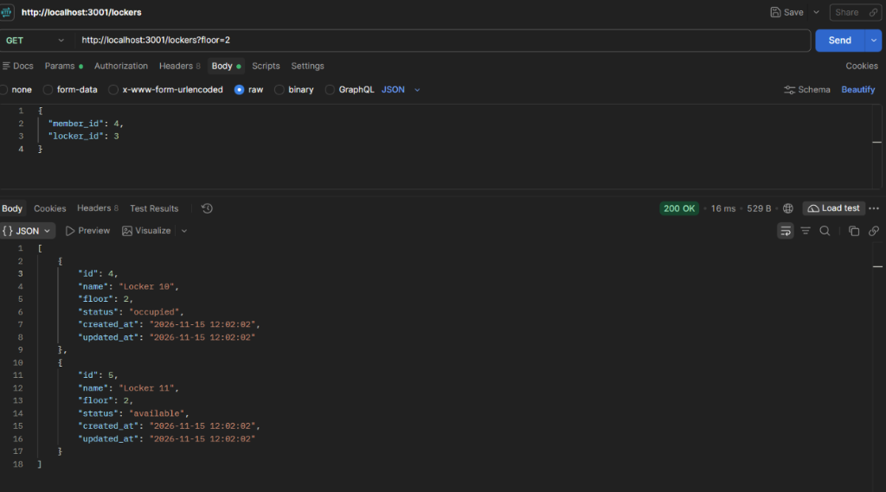
*Search Lockers by Floor – GET /lockers?floor=2 returns 200 OK with lockers filtered by floor 2.*

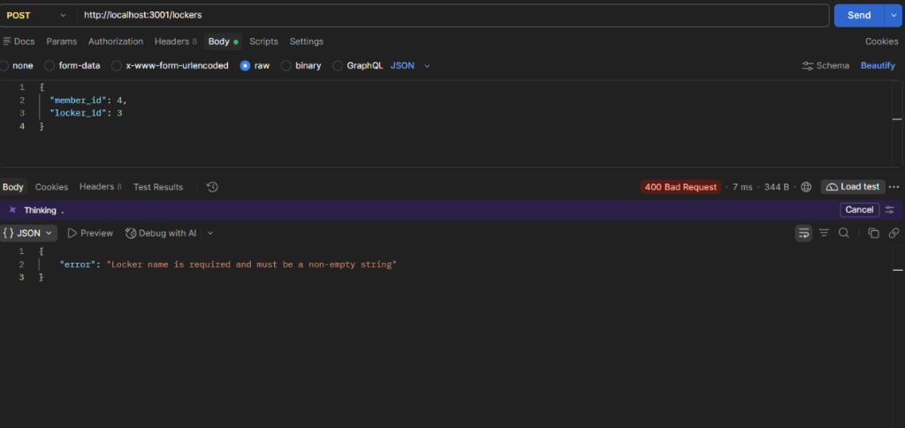
*Input Validation Error 400 Bad Request – POST /lockers rejects missing required fields with HTTP 400.*

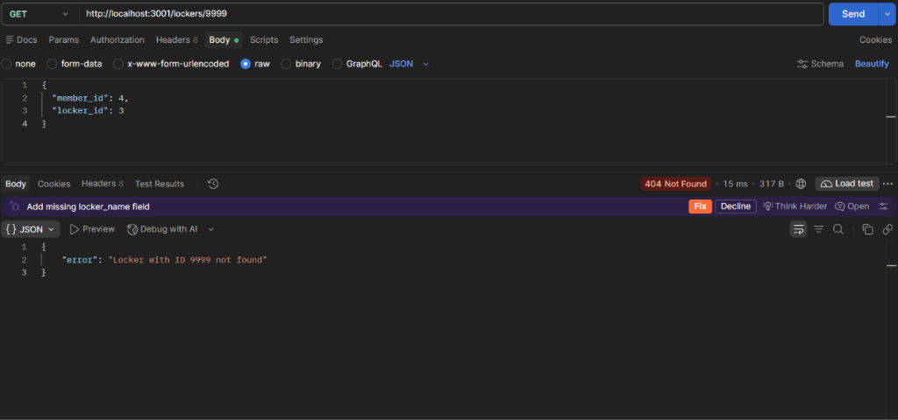
*Resource Not Found 404 – GET /lockers/9999 returns clear HTTP 404 error response.*

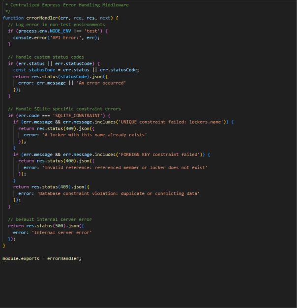
*Centralized Error Handler – errorHandler.js centralizing error responses and SQLite constraint violations.*

### 14.5 Part 5 – Twist Rule: Uppari Varun Kumar (`252U1R7094`)
- **Folder**: [`screenshots/05_Varun_Twist_Rule/`](screenshots/05_Varun_Twist_Rule)
- **Verified Screenshots Attached**:
  1. [`01_twist_test_1_create_201.png`](screenshots/05_Varun_Twist_Rule/01_twist_test_1_create_201.png) – Adding `"Locker 12"` returning HTTP 201 Created.
  2. [`02_twist_test_2_duplicate_409.png`](screenshots/05_Varun_Twist_Rule/02_twist_test_2_duplicate_409.png) – Adding `"locker 12"` returning HTTP 409 Conflict with exact error `{"error": "Locker 12 already exists"}`.
  3. [`03_twist_test_3_rename_409.png`](screenshots/05_Varun_Twist_Rule/03_twist_test_3_rename_409.png) – Renaming another locker (`Locker 20`) to `"Locker 12"` returning HTTP 409 Conflict.
  4. [`04_twist_self_update_200.png`](screenshots/05_Varun_Twist_Rule/04_twist_self_update_200.png) – Self-update: updating floor without name collision returning HTTP 200 OK.
  5. [`05_jest_automated_twist_tests.png`](screenshots/05_Varun_Twist_Rule/05_jest_automated_twist_tests.png) – Jest twist test suite execution (8/8 passing including concurrency test).
  6. [`06_full_test_suite_49_passing.png`](screenshots/05_Varun_Twist_Rule/06_full_test_suite_49_passing.png) – Full Jest test suite execution (4/4 test suites, 49/49 passing).

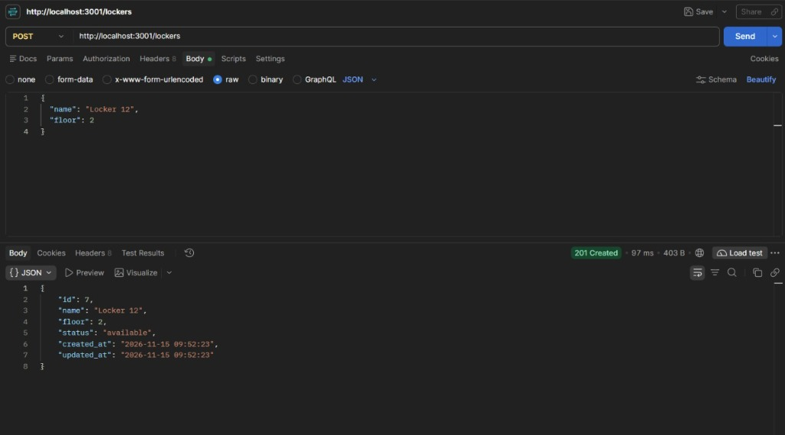
*Twist Test 1 – Add Locker 12: POST /lockers creates "Locker 12" returning HTTP 201 Created.*

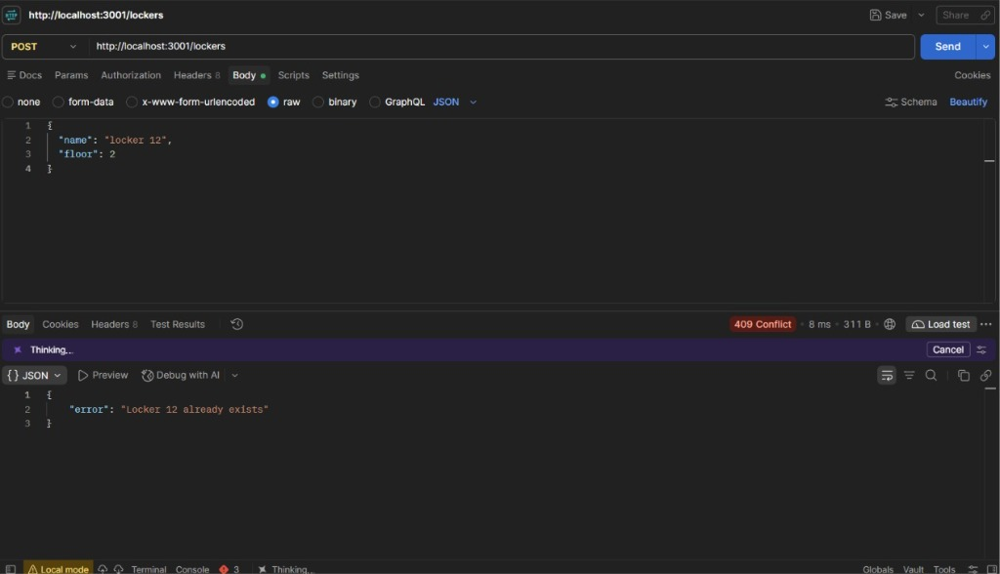
*Twist Test 2 – Duplicate Name: Attempting to add lowercase "locker 12" rejected with HTTP 409 Conflict.*

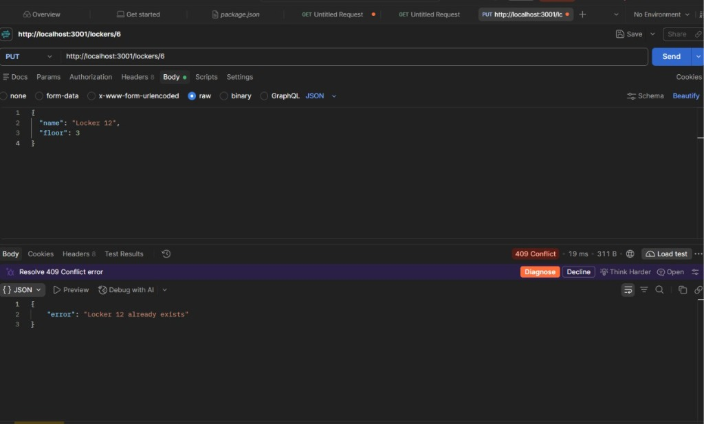
*Twist Test 3 – Rename Collision: Renaming existing locker to "Locker 12" returns HTTP 409 Conflict.*

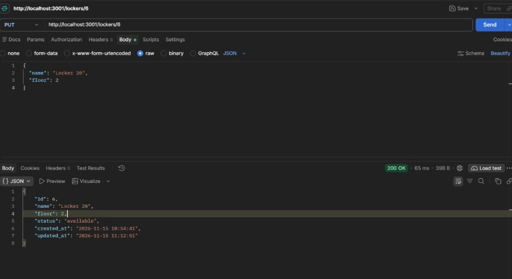
*Twist Self Update: Updating floor on own locker while retaining name returns HTTP 200 OK.*

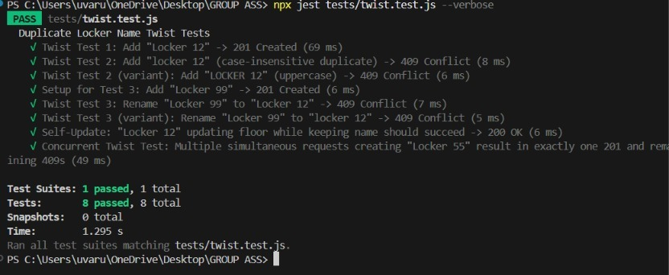
*Jest Automated Twist Tests – 8/8 twist tests passing including concurrent race conditions.*

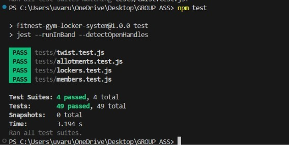
*Full Automated Test Suite – All 4 test suites and 49 automated unit/integration tests passing.*

### 14.6 Part 6 – Postman & README: Yelluri Navadeep Kumar (`252U1R7100`)
- **Folder**: [`screenshots/06_Navadeep_Postman_README/`](screenshots/06_Navadeep_Postman_README)
- **Verified Screenshots Attached**:
  1. [`01_postman_collection_runner.png`](screenshots/06_Navadeep_Postman_README/01_postman_collection_runner.png) – Postman collection execution summary showing all 34 requests executed and 68 assertions passed (0 failures).
  2. [`02_isolated_test_server_port_3001.png`](screenshots/06_Navadeep_Postman_README/02_isolated_test_server_port_3001.png) – Terminal showing isolated test server running on port 3001 with `fitnest_test.db` while production database remains safe.
  3. [`03_database_isolation_proof.png`](screenshots/06_Navadeep_Postman_README/03_database_isolation_proof.png) – Terminal executing `reset-test-db.js`, confirming test database reset and verification that `fitnest.db` is UNCHANGED.

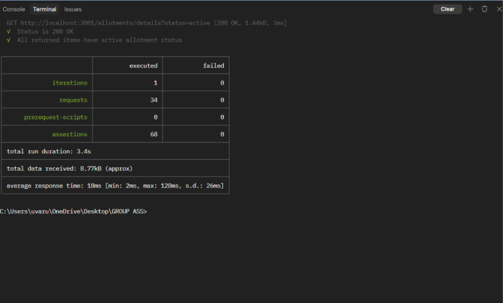
*Postman Collection Test Runner – 34 requests executed with 68 passing assertions and 0 failures.*

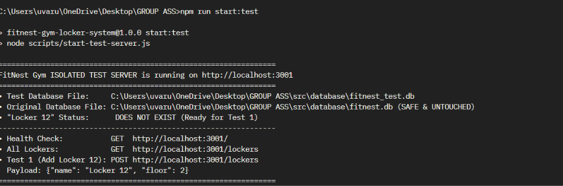
*Isolated Test Server (Port 3001) – Test server executing on port 3001 with isolated fitnest_test.db.*

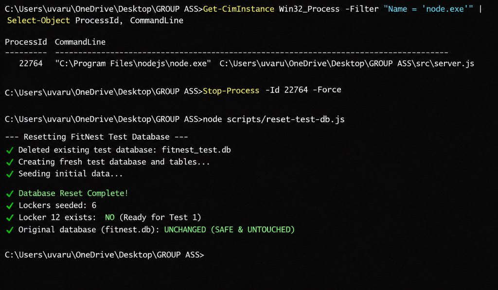
*Database Isolation Proof – Resetting test database while verifying production fitnest.db remains untouched.*

---

## 15. Group Assignment Submission Details

- **Project Title**: FitNest Gym – Locker Room Management System
- **Course**: B.Tech - Backend Development Fundamentals (BDF)
- **Submission Date**: November 2026
- **Status**: Completed & Verified (100% of requirements met, 49 automated Jest tests passing, 34 Postman requests with 68 passing assertions)

